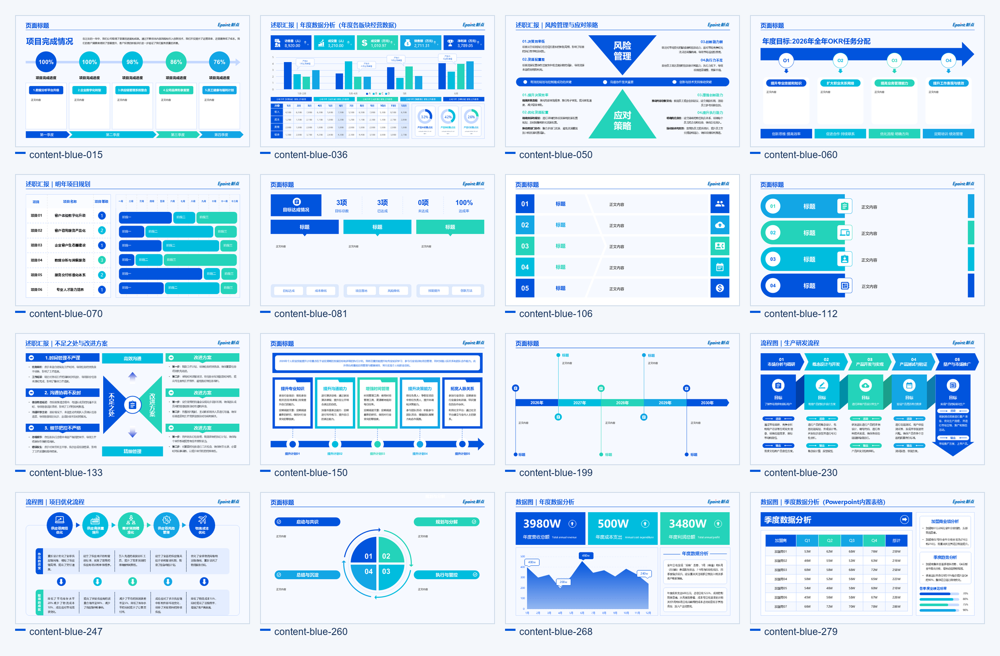
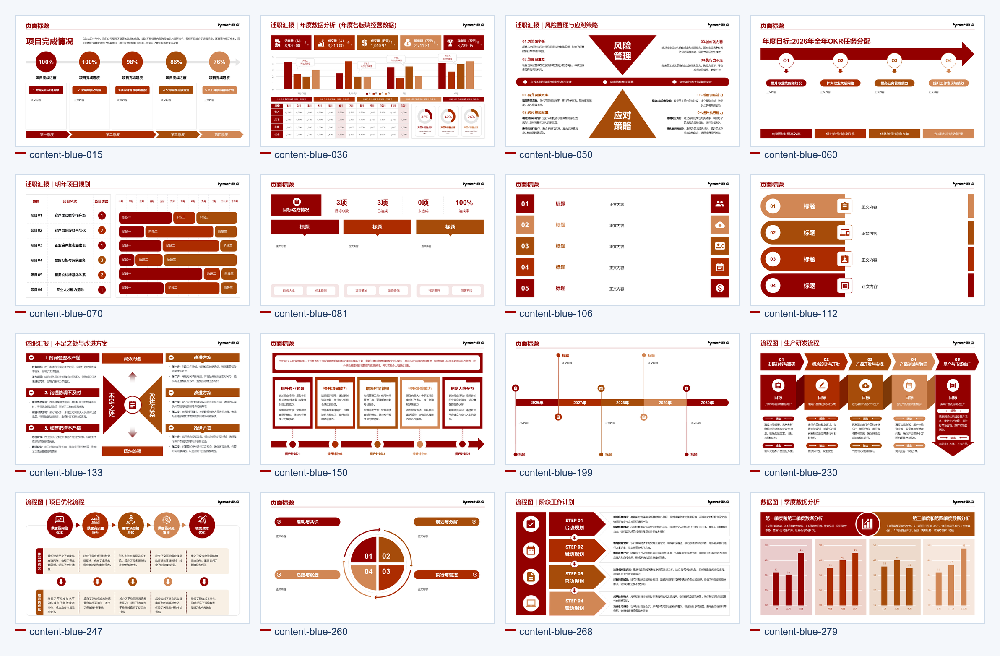
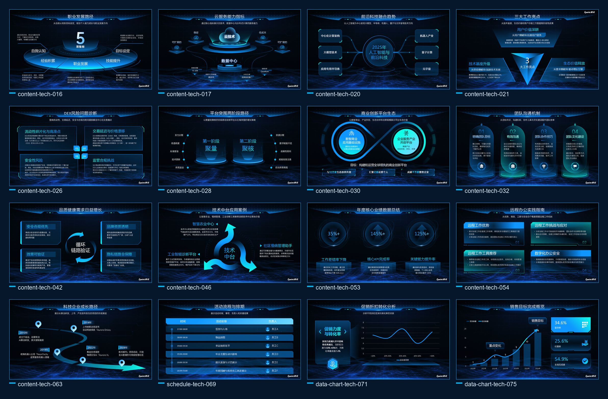

# Epoint Presentation 知识库

这是供 [Epoint Presentation 技能](https://github.com/camillechi2018/Epoint-Presentaion)调用的结构化 PPT 模板知识库。仓库保存可编辑来源页、组件字段与容量规则、主题资料和验收记录。技能按内容关系筛选组件，再试填、渲染；是否进入自动选稿，以当前记录的主题、页面职责、验收状态、项数及字段容量共同判断。

> 资产状态：`draft_pending_review`。使用草稿组件须显式允许并进行人工审阅；预览图不代表该组件的所有能力均已验收。

## 三种风格预览

蓝色、红色、科技风格各展示 16 个正文组件。图片中的文字和数字是版式示例，实际出稿以用户材料替换。

| 蓝色系 · 蓝白简约 | 红色系 · 红白简约 | 科技风格 · 深蓝科技 |
| --- | --- | --- |
|  |  |  |

[蓝红封面及内容视觉索引](review/视觉索引.html) · [科技风 85 页索引](review/深蓝科技风85页索引.html)

蓝红组件按 `style_family=legacy-blue-red` 处理，以 `theme=blue/red` 区分色系；科技风使用独立的 `style_family=deep-blue-tech`。绿色实验主题不进入常规选择。

## 资产规模与统计口径

以下数字按本次整理时 `main` 分支文件统计。**来源页位、候选记录、已验证记录与主题版本不能相加，也不等于可直接调用的版式数量。** 运行时应以当前提交的目录与组件记录为准。

| 口径 | 数量 | 来源与含义 |
| --- | ---: | --- |
| 来源页位 | 734 | `source-pages.json`；早期 611 页位是扩充前口径。 |
| 可编辑来源稿 | 6 份 | `sources/` 中的蓝、红、封面、科技风和蓝红补充稿。 |
| 候选组件 | 437 条 | `catalog.json`，包含尚未验收的候选。 |
| 分类已验证 | 168 条 | `classification_status=verified`；仍需检查具体输出能力。 |
| 其中正文组件 | 117 条 | 上述记录中排除封面、目录、章节页和封底。 |

组件可按需从来源页提取；登记了 `ready_source_by_theme` 的组件应优先使用已修整的可编辑单页。`source`、`red_source` 用于原稿追溯。来源页的显式色与图片不自动成为自由绘制时可用的颜色素材。

## 内容如何匹配组件

1. 先选整套风格与页面职责。封面、目录、章节页、封底严格按角色匹配；正文按已验收的信息关系检索。
2. 从 [`catalog.json`](catalog.json)、[`relation-taxonomy.json`](relation-taxonomy.json) 和组件规则检查主题、分类、PPTX 支持、媒体、原生项数与 `verified_counts`。`search_label` 只用于排序。
3. 按 `bindings.json` 检查语义字段、字数、行数、行宽并试填。不能删空固定项数，也不能借模板示例内容补业务事实。
4. 在 PowerPoint 中检查文字边界、图片、Logo、颜色及整稿节奏。候选命中和程序试填成功仍需最终视觉复核。

正文无合适组件时，由[技能](https://github.com/camillechi2018/Epoint-Presentaion)按同一风格使用内置排版规则或受约束的自由编排，并单独记录页面来源。

## 长文案与变项数

[正文长文案容量表](review/body-longcopy-capacity.json)覆盖 117 个正文组件、189 个蓝红科技主题版本。`physical_max_cjk_chars` 是单框实测极限，`recommended_max_cjk_chars` 是参考值；组稿优先使用更严格的 `use_for_planning_cjk_chars`，拥挤字段还须遵守 `visual_safe_max_cjk_chars`。117 个正文组件已按登记的可调用字数完成签收，见[视觉复核记录](review/body-longcopy-visual-review.md)。真实文案仍须通过行宽、行数和整页渲染。

变项数只按**具体组件**的 `verified_counts` 开放。蓝红目录、科技目录各有自己的已验收范围；其他流程或清单的变项数原型，不因目录可变而自动开放。固定项数组件只接受已登记的原生数量。

## 能力边界

| 能力 | 当前规则 |
| --- | --- |
| 静态可编辑 PPTX | 主题、字段、项数与 PPTX 验收状态均适配后使用；草稿还须人工审阅。 |
| 长文案 | 按逐字段安全容量试填；超容量压力样例失败，不代表所有长文案均不可用。 |
| 跨色系变量换色 | 蓝红双版本不等于任意来源页都能换色；按组件专项状态判断。 |
| 动效与 HTML | 有内部原型；静态 PPTX 验收不代表这些能力已验收。 |
| 目录及其他变项数 | 按该组件的 `verified_counts` 使用，不作整库统一承诺。 |

## 文件导航

| 路径 | 内容 |
| --- | --- |
| [`source-pages.json`](source-pages.json)、[`sources/`](sources/) | 来源页索引与可编辑原稿。 |
| [`catalog.json`](catalog.json)、[`layouts/`](layouts/) | 候选组件、绑定、规则与 ready 单页。 |
| [`relation-taxonomy.json`](relation-taxonomy.json) | 信息关系及同义词索引。 |
| [`themes/`](themes/)、[`brand/`](brand/) | 主题变量与品牌素材。 |
| [`source-previews/`](source-previews/)、[`cover-images/`](cover-images/) | 来源页预览与封面图库。 |
| [`review/`](review/) | 容量、静态 PPTX 和专项修整的验收证据。 |
| [`knowledge-manifest.json`](knowledge-manifest.json) | 供技能校验下载内容的文件哈希清单。 |

知识库模板和品牌素材仍处于 `draft_pending_review`。授权说明见[技能仓库的 LICENSE](https://github.com/camillechi2018/Epoint-Presentaion/blob/main/LICENSE)；本仓库公开可读不表示获得再分发或商用授权。
